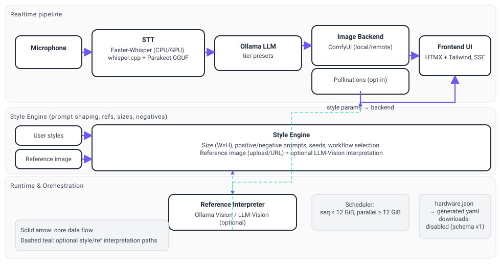

## Realtime Speech to Image Slideshow Generator

Whisper–Ollama–ComfyUI pipeline for AI live illustrations via a FastAPI browser UI — local by default, LAN‑friendly, cloud optional (Pollinations). Zero subscriptions, zero vendor lock‑in: keep your data and your stack.

Perfect for streamers, lecturers, and storytellers: turn live speech into compelling visuals in seconds.

---

## Highlights

- Fully local pipeline: Microphone → STT → LLM prompt → ComfyUI image
- Docker‑first with automatic VRAM tiering and generated runtime config
- STT options:
  - Faster‑Whisper (kept; 6gb default on CPU int8)
  - Parakeet TDT 0.6B v3 as a GGUF model via whisper.cpp (pywhispercpp)
- LLM via Ollama with tier‑based model presets
- Image via ComfyUI (SD1.5+LCM for 6–8 GiB; FLUX.2 small FP8 for ≥16 GiB)
- Optional image via Pollinations
- Style Engine:
  - Width/height, positive/negative prompts, seeds
  - Workflow selection (ComfyUI)
  - Reference images (upload or URL) with optional LLM‑Vision interpretation for content/style extraction
- Server‑Sent Events (SSE) UI with Start/Stop, styles, gallery, fullscreen
- No silent cloud fallbacks; Pollinations is opt‑in and disabled by default
- Strict download policy: no automatic model downloads

---

## What’s new and current

- VRAM auto‑detection (NVML/pynvml) + config generator (YAML)
  - hardware_detect.py → /app/config/hardware.json
  - config_generator.py → /app/config/generated.yaml
- VRAM scheduler: sequential &lt; 12 GiB; parallel ≥ 12 GiB
- Parakeet TDT 0.6B v3 available as GGUF via whisper.cpp (pywhispercpp); Faster‑Whisper remains supported
- Docker Compose stack: init / ollama / comfyui / backend
- model_downloader.py enforces “downloads disabled” (no network)

---

## Hardware tiers (auto‑selected)

- 6gb (6–8 GiB): STT CPU int8, Ollama qwen3:1.7b‑q4, SD1.5+LCM 512, sequential
- 8gb (8–12 GiB): STT CUDA fp16, qwen3:4b‑q4, SD1.5+LCM 768, sequential
- 16gb (12–16 GiB): STT CUDA, gemma4:26b‑a4b‑q4, FLUX.2 small FP8 1024, parallel
- 24gb (16+ GiB): STT CUDA, qwen3.8:27b‑q4, FLUX.2 small (+Qwen‑Image opt.), parallel

Override safely with SLAIDSHOW_TIER=6gb|8gb|16gb|24gb (only smaller‑or‑equal than detected VRAM).

---

## Quick Start (Docker)

Prerequisites
- NVIDIA Driver + NVIDIA Container Toolkit (for GPU)
- Docker + docker compose plugin
- Git

1) Clone and env
- git clone &lt;repo&gt; && cd slAIdshow
- cp .env.example .env
- Optional: set SLAIDSHOW_TIER=6gb in .env for a conservative profile; set POLLINATIONS_SECRET only if you plan to use Pollinations

2) Start backends
- docker compose up -d ollama comfyui

3) Initialize config (one‑shot)
- docker compose up init
  - Writes ./config/hardware.json and ./config/generated.yaml
  - Validates runtime config
  - Enforces disabled download policy (no network)

4) Start app
- docker compose up -d backend
- Open http://127.0.0.1:8080

Notes
- Models are not auto‑downloaded:
  - Ollama: docker exec -it slaidshow_ollama ollama pull qwen3:1.7b-q4 (or your tier model)
  - ComfyUI: place checkpoints in its models folder per your workflow
  - STT (whisper.cpp): place your GGUF (e.g., tdt-0.6b-v3-q8_0.gguf) under ./models if referenced
- Default ports (localhost): Ollama 11434, ComfyUI 8188, Backend 8080
- Logs: docker compose logs -f backend | ollama | comfyui

Update
- docker compose pull && docker compose build --pull && docker compose up -d

---

## Minimal Native Setup

Linux (Debian/Ubuntu) system deps
- sudo apt update
- sudo apt install -y build-essential cmake pkg-config python3-dev libportaudio2 libasound2-dev

Windows
- Python 3.12 (x64), VC++ Build Tools if needed
- Consider WSL for Linux‑like setup if audio/GPU is tricky

Create venv and install
- python -m venv .venv
- source .venv/bin/activate          (PowerShell: .\.venv\Scripts\Activate.ps1)
- pip install -r requirements.txt

Generate config (GPU path)
- python hardware_detect.py --output ./config/hardware.json
- python config_generator.py --hardware ./config/hardware.json --output ./config/generated.yaml
- Or force smaller profile: SLAIDSHOW_TIER=6gb python config_generator.py --hardware ... --output ...

Run the app

    source .venv/bin/activate
    uvicorn app:app --host 0.0.0.0 --port 8080

- Open http://127.0.0.1:8080

CPU / Remote image option
- Keep Faster‑Whisper on CPU (int8) for 6gb profiles
- Use whisper.cpp with a Parakeet GGUF (e.g., tdt-0.6b-v3-q8_0.gguf) if desired
- Point to a LAN ComfyUI (set remote host/port in env/config)

---

## STT Backends

- Faster‑Whisper
  - Default on 6gb (CPU int8) to keep VRAM free
- Parakeet TDT 0.6B v3 via whisper.cpp
  - Provided as a GGUF for pywhispercpp (not a separate native backend)
  - Configure model path in your settings; no auto‑downloads

---

## Configuration & Paths

- ./config/hardware.json — exact NVML snapshot (bytes), schema 1
- ./config/generated.yaml — effective runtime config (STT/LLM/Image/Scheduler)
- ./models — local model storage (Ollama volume separate in Docker)
- ./outputs — images/logs
- ./recordings — reserved for upcoming recording feature

Env overrides
- SLAIDSHOW_TIER=6gb|8gb|16gb|24gb (only &lt;= detected tier)
- GPU_INDEX to select a specific GPU before running hardware_detect.py

---

## Operating Modes

- Fully local: STT (Faster‑Whisper or whisper.cpp+Parakeet GGUF), Ollama, ComfyUI on the same machine
- CPU/Low‑end + Remote ComfyUI: app + Ollama local, images via LAN ComfyUI
- Cloud (Pollinations): optional and disabled by default (BYOP planned)

---

## Security & Privacy

- Cloud and remote backends are disabled by default
- No silent cloud fallbacks; enable explicitly if required
- model_downloader.py never downloads — it validates the “downloads disabled” policy (schema v1)
- Keep secrets out of git; never commit your .env

---

## License

MIT License — see the LICENSE file.

---

## Credits

- Speech‑to‑text: Faster‑Whisper, Parakeet (GGUF via whisper.cpp)
- LLM: Ollama
- Images: ComfyUI
- Backend: FastAPI + SSE

Contributions and issues are welcome — please include logs and env details (.env sanitized).

### Contact

- Betakontext | Christoph Medicus — dev@betakontext.de — https://dev.betakontext.de

### Support

Buy me a coffee on https://buymeacoffee.com/betakontext
